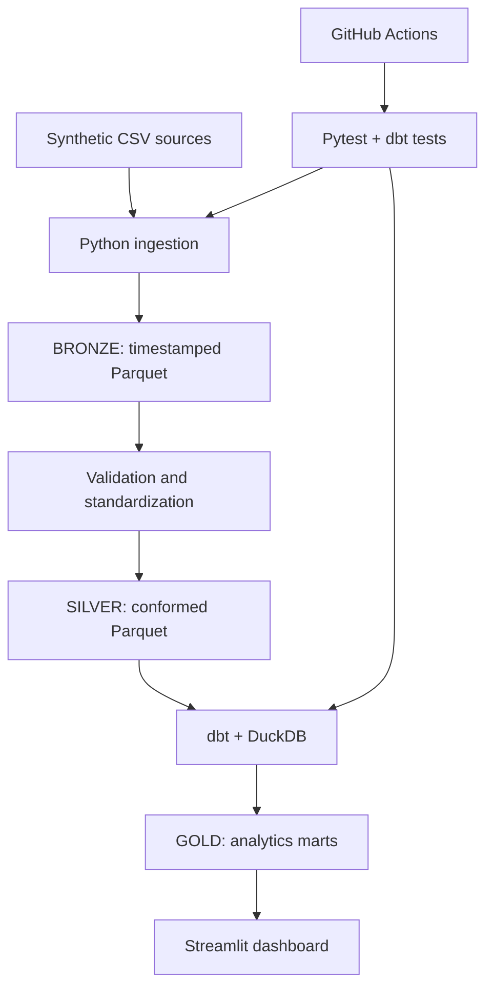

# Clinical Data Engineering Platform

An end-to-end, local-first data engineering project using entirely synthetic clinical-trial operations data. It demonstrates ingestion, medallion architecture, validation, transformation, dimensional modeling, automated tests, CI, and analytics.

> **Data notice:** All records are synthetic. No real patient information is used. This is a portfolio demonstration, not a clinical decision-support system.

## Architecture



## Stack
Python 3.11 · SQL · DuckDB · Parquet · dbt Core/dbt-duckdb · Pandas · Pytest · Streamlit · Docker · GitHub Actions.

## Quick start

```bash
git clone https://github.com/YOUR_USERNAME/clinical-data-engineering-platform.git
cd clinical-data-engineering-platform
python -m venv .venv
# macOS/Linux: source .venv/bin/activate
# Windows: .venv\Scripts\Activate.ps1
pip install -e ".[dev]"
python -m clinical_pipeline generate
python -m clinical_pipeline run
streamlit run app/streamlit_app.py
```

Run tests with `pytest`; lint with `ruff check .`.

## Project structure

```text
clinical-data-engineering-platform/
├── .github/workflows/ci.yml
├── app/streamlit_app.py
├── data/{source,bronze,silver,warehouse}/
├── dbt/
│   ├── models/staging/
│   ├── models/marts/
│   ├── tests/
│   ├── dbt_project.yml
│   └── profiles.yml
├── docs/{architecture,data_dictionary}.md
├── src/clinical_pipeline/
│   ├── __init__.py
│   ├── __main__.py
│   ├── config.py
│   ├── generate.py
│   ├── ingest.py
│   ├── transform.py
│   └── runner.py
├── tests/
├── Dockerfile
├── Makefile
├── pyproject.toml
└── requirements.txt
```

## Data entities

- `patients`: synthetic participant, trial, site, enrollment, age, and status.
- `trials`: trial name, therapeutic area, phase, and site count.
- `visits`: participant visit events, dates, and statuses.
- `lab_results`: synthetic ALT, AST, CRP, and hemoglobin measurements.

Gold models include `dim_patient`, `dim_trial`, `fct_visit`, and `mart_trial_operations`.

## Engineering features

- Deterministic synthetic source generator.
- Immutable timestamped Bronze snapshots.
- Silver schema, domain, uniqueness, and referential-integrity checks.
- dbt dimensional models and data tests.
- DuckDB analytical warehouse and Parquet storage.
- Pipeline run metadata and row-count logging.
- Local-first execution; no cloud credentials or paid services required.

## Optional Snowflake extension

A follow-on version can add Snowflake stages, `COPY INTO`, `RAW`/`CURATED`/`ANALYTICS` schemas, and a `dbt-snowflake` profile. Keep credentials in environment variables or GitHub Secrets; never commit secrets.

## Portfolio checklist

1. Run the pipeline and tests locally.
2. Capture a dashboard screenshot in `docs/`.
3. Push the repository and confirm GitHub Actions passes.
4. Record a 60–90 second demo.
5. Add a release tag after validating the build.

## Resume bullet (use after verifying the project)

Built an end-to-end clinical data engineering platform using Python, SQL, DuckDB, Parquet, and dbt; implemented medallion architecture, reproducible ingestion, data quality validation, dimensional marts, automated testing, CI, and analytics reporting.
