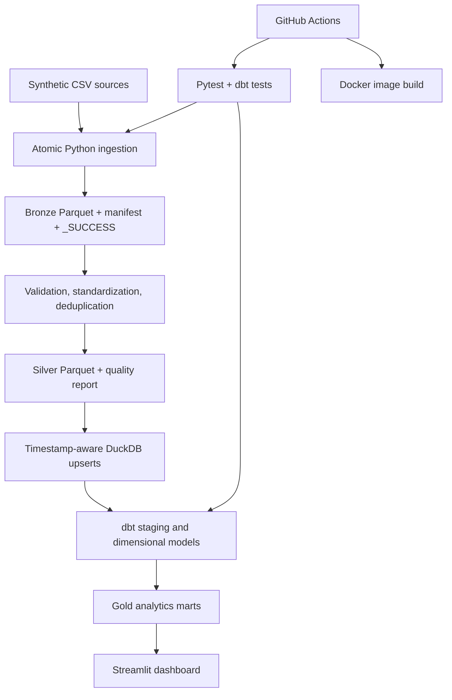

# Clinical Data Engineering Platform

An end-to-end, local-first data engineering portfolio project built with synthetic clinical-trial operations data. It demonstrates reproducible ingestion, a Bronze/Silver/Gold medallion architecture, timestamp-aware DuckDB upserts, dbt dimensional modeling, data-quality reporting, automated tests, CI, Docker, and a Streamlit dashboard.

> **Data notice:** All records are synthetic. No real patient information is used. This is a portfolio demonstration, not a clinical decision-support system.

## Architecture



## Technology stack

Python 3.11+ · SQL · DuckDB · Parquet · Pandas · dbt Core/dbt-duckdb · Pytest · Ruff · Streamlit · Docker · GitHub Actions.

## Quick start (Windows PowerShell)

```powershell
git clone https://github.com/YOUR_USERNAME/clinical-data-engineering-platform.git
Set-Location .\clinical-data-engineering-platform

py -3.11 -m venv .venv
.\.venv\Scripts\Activate.ps1

python -m pip install --upgrade pip
python -m pip install -e ".[dev]"

python -m clinical_pipeline generate
python -m clinical_pipeline run
streamlit run app/streamlit_app.py
```

The first `run` creates Bronze and Silver data, updates the local DuckDB warehouse, and runs `dbt build` (models and data tests).

## Simulate a source-system update

Run this after the baseline source data has been generated and loaded:

```powershell
python -m clinical_pipeline simulate
python -m clinical_pipeline run --no-generate
```

The simulator changes a small number of source records and advances their `source_updated_at` timestamps. The next run reads the complete source snapshot and applies timestamp-aware upserts. Existing records are updated only when their incoming source timestamp is newer.

**Incremental-processing scope:** this implementation is incremental at the DuckDB upsert layer, but it still reads complete CSV/Bronze/Silver snapshots. It is not source-side CDC and does not yet extract only changed source records. A table-level maximum timestamp is recorded for observability; it is not used as a global filter because that could miss late-arriving updates for older entities.

## Commands

| Command | Purpose |
|---|---|
| `python -m clinical_pipeline generate` | Regenerate deterministic synthetic CSV source data |
| `python -m clinical_pipeline run` | Run ingestion, transformation, upserts, and dbt |
| `python -m clinical_pipeline run --no-dbt` | Run Python pipeline without dbt |
| `python -m clinical_pipeline run --no-generate` | Use existing source CSV files |
| `python -m clinical_pipeline simulate` | Simulate source record updates |
| `pytest --cov=clinical_pipeline` | Run Python tests with coverage |
| `ruff check .` | Lint the repository |
| `ruff format .` | Format Python files |
| `streamlit run app/streamlit_app.py` | Start the dashboard |
| `docker compose up --build` | Build and start the containerized dashboard |

## Project structure

```text
clinical-data-engineering-platform/
├── .github/workflows/ci.yml
├── app/
│   ├── dashboard_queries.py
│   └── streamlit_app.py
├── dbt/
│   ├── models/staging/
│   ├── models/marts/
│   ├── tests/
│   ├── dbt_project.yml
│   └── profiles.yml
├── docs/
├── src/clinical_pipeline/
│   ├── config.py
│   ├── generate.py
│   ├── ingest.py
│   ├── incremental.py
│   ├── quality.py
│   ├── runner.py
│   ├── simulate_changes.py
│   └── transform.py
├── tests/
├── Dockerfile
├── docker-compose.yml
├── Makefile
├── pyproject.toml
└── requirements.txt
```

## Medallion layers

- **Source:** deterministic CSV files for patients, trials, visits, and lab results.
- **Bronze:** immutable, timestamped Parquet batches. Each published batch includes a manifest and `_SUCCESS` marker. Incomplete staging batches are ignored.
- **Silver:** standardized, deduplicated, validated Parquet tables. A machine-readable quality report records source rows, Silver rows, and deduplicated rows.
- **Warehouse/Gold:** DuckDB tables maintained through per-record `source_updated_at` comparisons; dbt builds dimensions, facts, and analytics marts.

## dbt models

- `dim_patient`: one row per synthetic participant.
- `dim_trial`: one row per synthetic trial.
- `fct_visit`: one row per participant visit.
- `fct_lab_result`: one row per laboratory measurement.
- `mart_trial_operations`: trial-level enrollment, visit, and lab metrics.
- `mart_lab_analyte`: lab metrics grouped by analyte and unit.
- `mart_site_performance`: enrollment and visit metrics grouped by trial and site.

## Reliability and quality controls

- Bronze batches are staged and published with a directory rename only after all files and metadata are written.
- Transformation ignores Bronze batches without a completion marker.
- Source timestamps are normalized to UTC before DuckDB upserts.
- Duplicate business keys are resolved by keeping the latest source timestamp; duplicate counts are visible in the quality report.
- Invalid schema, timestamps, domain values, and referential relationships fail the transformation rather than being silently discarded.
- Python tests cover deterministic generation, ingestion, transformation, upserts, and pipeline audit behavior.
- dbt tests cover key uniqueness, nullability, relationships, accepted values, and reference-range integrity.

## Configurable data directory

Set `CLINICAL_DATA_DIR` to store generated data outside the repository:

```powershell
$env:CLINICAL_DATA_DIR = "D:\clinical-platform-data"
python -m clinical_pipeline run
```

The Streamlit dashboard uses the same environment variable.

## Docker

```powershell
docker compose up --build
```

Open `http://localhost:8501`. Docker creates synthetic data inside a named volume; it does not copy local warehouse files into the image.

## Privacy and intended use

All data is synthetic and generated for software engineering demonstration. The project must not be used to store or process real protected health information (PHI), and its lab reference ranges are illustrative only.

## Portfolio checklist

1. Run the full pipeline and Python tests.
2. Confirm `dbt build` passes.
3. Start the dashboard and capture a screenshot in `docs/`.
4. Push the repository and confirm GitHub Actions passes.
5. Record a short demo showing ingestion, simulated updates, dbt marts, and dashboard metrics.

## Resume bullet (use after verifying your run)

Built a local-first clinical data engineering platform using Python, SQL, DuckDB, Parquet, and dbt; implemented atomic batch ingestion, timestamp-aware upserts, data-quality reporting, dimensional analytics marts, automated testing, CI, Docker, and a Streamlit operations dashboard.
